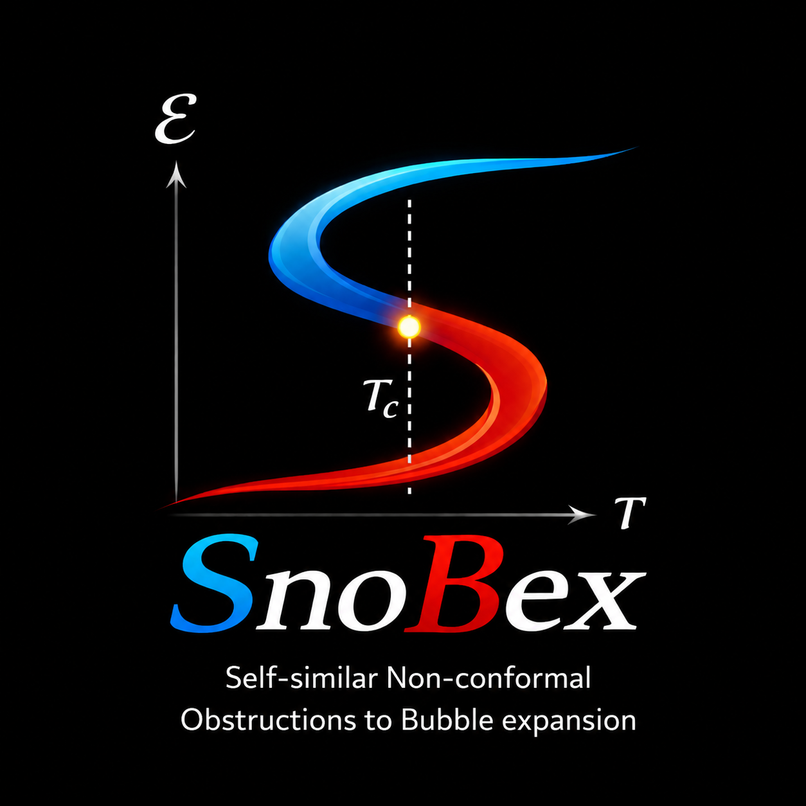

# snobex
## Self-similar Non-conformal Obstructions to Bubble expansion


<p align="center">
  
</p>

snobex (Self-similar Non-conformal Obstructions to Bubble expansion) computes self-similar hydrodynamic bubble solutions
(detonations, deflagrations, hybrids, and shocked detonations) for cosmological first-order
phase transitions, for a general equation of state.

---

## Features

- Interactive EoS explorer with real-time thermodynamic plots (GUI),
  including the critical-temperature common-tangent construction on the
  entropy–energy panel.
- Full phase-space computation: detonations, deflagrations, hybrids, and
  shocked detonations.
- Automatic separator curves for different type of solutions.
- Click-to-inspect: click any point in the phase-space plot to display
  the corresponding velocity and energy profiles.
- Built-in α_N (phase-transition strength) computation.
- **Custom EoS support**: load a tabulated (T, p, e, s) EoS from a
  plain-text file, split it into its two branches and replace the analytic
  parametrisations entirely.
- Parallel computation via `concurrent.futures`.
- Optional result pickling for post-processing.

---

## Solution types

- **Detonation** — supersonic wall with a rarefaction behind it.
- **Deflagration** — subsonic wall with a shock ahead of it.
- **Hybrid** — detonation wall preceded by a rarefaction in the LT phase.
- **Shocked detonation** — detonation whose rarefaction is terminated by an
  additional shock inside the LT fluid (two discontinuities). Only the
  candidates that satisfy the entropy condition at the shock are retained.

---

## Installation

```bash
pip install numpy scipy matplotlib
```

No additional packages are required.  Clone or download the repository
and run scripts from its root directory.

---

## File structure

```
snobex/
    __init__.py          Package entry point and public API
    eos.py               EoS models (pplus, pminus) and custom EoS loader
    thermodynamics.py    Entropy ODEs, temperature, free energy, T_c
    hydrodynamics.py     Junction conditions and flow solvers
    separators.py        Phase-space separator and contour finders
    plotting.py          Interactive phase-space bubble plot

main_eos_explorer.py     Interactive EoS explorer GUI (start here)
main_bubble_solver.py    Standalone bubble phase-space solver
```

---

## Quick start

### 1. EoS explorer (recommended starting point)

```bash
python main_eos_explorer.py
```

Use the sliders to tune the EoS parameters and watch the thermodynamic
quantities update in real time.  Click **"Compute all bubbles"** to
launch the full phase-space computation.

### 2. Standalone bubble solver

Edit the parameter block at the top of `main_bubble_solver.py`, then:

```bash
python main_bubble_solver.py
```

### 3. Scripting

```python
from snobex.plotting import interactive_bubble_plot

fig, ax = interactive_bubble_plot(
    eTH=0.5, eTL=2.0,
    p1=0.0, p0=0.0, n=4.0, delta=1.0,
    nucleation_energies_allowed=(0.5, 2.0),
    bubble_energies_allowed=(1e-6, 2.0),
    xiw_resolution=50,
    en_resolution=50,
)
```

---

## Custom EoS

To replace the analytic model with tabulated data, provide a plain-text
table of the whole equilibrium curve (stable, metastable and unstable
parts, e.g. from holography or the lattice) with columns for p and e, and
optionally T and s:

```
# T      p        e        s
1.0055   0.1451   5.0500   5.1666
...
```

Then set `CUSTOM_EOS_FILE` in either entry-point script:

```python
# main_bubble_solver.py
CUSTOM_EOS_FILE    = "Data_holo/thermo_phiM1.txt"
CUSTOM_EOS_COLUMNS = (0, 6, 7, 1)   # columns of (T, p, e, s) in the file
CUSTOM_EOS_TC      = None           # set to 1.0 for tables in units of T_c
CUSTOM_EOS_CS2_FROM = 'Ts'          # c_s² = (s/T) dT/ds instead of dp/de
```

If the table has no T and s columns (set them to `None` in
`CUSTOM_EOS_COLUMNS`, e.g. `(None, 1, 0, None)` for an (e, p) file), they
are rebuilt from p(e) along the whole curve: de = T ds and e + p = T s give
d ln s = de / (e + p) and T = (e + p) / s.  This fixes them up to one
constant factor, which does not affect which solutions are allowed; it is
chosen so that T_c = 1.

`CUSTOM_EOS_CS2_FROM` picks how c_s² is computed: `'pe'` (dp/de, default)
or `'Ts'` ((s/T) dT/ds, equal by dp = s dT and de = T ds).  Use `'Ts'` for
holographic tables, whose p column is noisy at low T and gives spurious
c_s² > 1/3 when differentiated; use `'pe'` for tables whose p was built from
a smooth c_s² (e.g. `eos_pure_YM_final.text`).

The loader (`snobex.eos.load_custom_eos`) splits the table into its HT and
LT branches at the turning points where c_s² = 0, and builds
p(e), c_s²(e), S(E) and T(E) on each branch (NaN outside it).  eTH, eTL,
T_c and the allowed nucleation and bubble energy ranges are taken from the
data, and the entropy condition and α_N use the tabulated S and T.  It
returns the keyword arguments of `interactive_bubble_plot`:

```python
from snobex import load_custom_eos, interactive_bubble_plot
interactive_bubble_plot(**load_custom_eos("my_eos.dat"))
```

---

## EoS parametrisation

The built-in two-phase model uses:

**High-temperature (HT) branch:**
```
p+(e) = (δ/3) ln cosh((e − e_TH)/δ) + C
```
where C is fixed by p+(e_TH) = p₁.

**Low-temperature (LT) branch:**
```
p−(e) = (1/3) [ e − e^(n+1) / ((n+1) e_TL^n) ]
```

---

## Parameters

| Symbol  | Description                              | Default |
|---------|------------------------------------------|---------|
| `eTH`   | HT branch turning-point energy           | 0.5     |
| `eTL`   | LT branch turning-point energy           | 2.0     |
| `p1`    | HT pressure at `eTH`                     | 0.0     |
| `delta` | HT smoothing scale                       | 1.0     |
| `n`     | LT shape exponent                        | 4.0     |
| `sTH`   | HT entropy anchor (sets T scale)         | 2.5     |
| `sTL`   | LT entropy anchor (sets T scale)         | 8.45    |

---

## Output files

When `saving=True` (or clicking "Compute all bubbles" with the flag
enabled), results are saved as a pickle file:

```
snobex_results_<eTH>_<eTL>_<p0>.pkl
```

Two profile files are written to `output_dir` after each click event:

- `vofxi.txt` — velocity profile v(ξ)
- `eofxi.txt` — energy profile e(ξ)

---

## License

Released under the MIT License.  See `LICENSE` for details.
